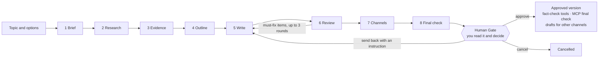

# OnTheBridge OBA

**A semi-automatic article-writing system with a human gate.**
The AI researches, extracts evidence, writes, checks and revises. **A person reads the result and decides.**
Nothing is ever published by the system.

OBA ("OnTheBridge Article") is the system behind [OnTheBridge](https://onthebridge.in.th/), a Thai publication
([details](#in-production)). It was built for a real editorial workflow, where one wrong "fact" costs more than a slower
process — so the design goal is not "fully automatic" but *"automatic where it is safe, human where it matters"*.

> 🇹🇭 สรุปภาษาไทยอยู่ที่ [README.th.md](README.th.md)

> **Status: early public release (0.1).** It runs a real publication's workflow, but this English edition is new,
> its English output has been exercised mainly through tests and the author's own checks, and it has been tested
> end to end on **one** publishing channel (see [Channels](#channels)). Read [the limits](#honest-limits) before relying on it.

---

## Why it is different from "AI writes my blog"

| Fully automatic tools | OBA |
|---|---|
| The AI writes and posts | The AI writes; **you** approve; **you** post |
| Facts come from the model's memory | Every fact needs a **source page the system actually opened**, and a **quote that is checked against that page's text** |
| "Looks good" | A fact that cannot be matched to its source is **kept out of the article** instead of being smoothed over |
| One score out of 100 | **No made-up quality scores.** Concrete issues, with the exact sentence and the fix |
| Approval is a click | Approval is tied to a **SHA-256 hash of the exact file you read**. Edit the file afterwards and the approval is void |
| Rules are in the code | Your editorial rules are **plain files** (`rules/`) that you own and can edit without touching code |

## How an article is made



1. **Brief** — picks a template and a content pillar (or uses yours), and plans the searches.
2. **Research** — runs real web searches, opens the real pages (including PDFs), skips social/video pages, filters off-topic pages.
3. **Evidence** — extracts facts, each with a type, a source and a quote. **Code** checks every quote against the fetched text; the AI cannot mark its own homework.
4. **Outline** — assigns each verified fact to exactly one of four slots.
5. **Write** — writes slot by slot, so length and structure hold up, and nothing is retold.
6. **Review** — code checks (length, duplicate paragraphs, leaked model output, invented openings…) plus an AI fact-checker that must point at the exact sentence. Fixes are made **sentence by sentence** in the existing draft, never by rewriting the whole piece.
7. **Channels** — builds the publishable text: your headings, numbered sources, an access-date footer, an image plan (no invented image links).
8. **Final check** — a last pass that only *reports*; it never approves.

Then the **Human Gate**: read the file, then **approve**, **send back with an instruction**, or **cancel**.

## Features

- **Evidence you can audit**: per-claim source, quote and rationale; four evidence types (primary text, study, corroborated, attributed testimony); an *evidence base* summary that warns when an article rests on one agency.
- **Human Gate** with hash-bound approvals, full decision history, and a copy of every version with a paragraph-level diff.
- **Fact check before posting** (code only, no AI): compares every number, name and quote in the final text with the source it cites. Optional **deep check** searches for a second independent source and Google Fact Check Tools. **Re-check sources** after publication detects pages that changed or vanished.
- **Your rules, your voice**: five article templates, a voice library, channel format and central rules are Markdown/YAML files in `rules/`. The ones shipped are **examples** — replace them.
- **Many models**: DeepSeek (default), Anthropic Claude, OpenAI, Google Gemini, OpenRouter. Cost tracker with per-model estimates.
- **Two languages**: write in **English** (default) or **Thai** per job.
- **[MCP server](docs/MCP.md)**: let Claude (Desktop or Code) do a *final check* of an approved article with read-only tools and one write tool that can only create new files in the job's `final/` folder. No publish tool, no approve tool.
- **Other channels**: drafts of Facebook / X / LinkedIn captions, a newsletter summary, a short-video script and plain HTML — from approved articles only.
- **Local and private**: a small Node.js server on `127.0.0.1`, no database, no accounts. Everything is files.

## Quick start

You need **Node.js 22 or newer** and an API key for at least one AI provider
(DeepSeek is the default and the most thoroughly exercised).

```bash
git clone <this-repository-url>
cd <the-folder>
npm install
cp .env.example .env        # Windows: copy .env.example .env
# open .env and paste your key, e.g. DEEPSEEK_API_KEY=...
npm start
```

Open **http://127.0.0.1:8080**, type a topic, press **Start the article**. On Windows you can also double-click `start.bat`.

A web-search key (Tavily, Serper or Brave) is **effectively required** — without one the system falls back to free Wikipedia
and DuckDuckGo lookups, and DuckDuckGo returns nothing to programs, so you get Wikipedia pages only.

➡️ **Full walkthrough: [docs/GUIDE.md](docs/GUIDE.md)** (Thai edition: [docs/GUIDE.th.md](docs/GUIDE.th.md)) (install, your first article, reading the results, the Human Gate,
posting, editing the rules, MCP, troubleshooting).

## Channels

The first (and so far only) channel exercised end to end is **Blockdit** — a Thai social publishing platform, where
articles from this system were posted by hand after passing the Human Gate. Treat "Blockdit" in the code and rules as the
name of a *long-article social channel with a cover image, headings, in-text images and a Sources list*; you can rename it
or change its format in `rules/BLOCKDIT_FORMAT.md` and `rules/Template/blockdit_article.md`.

The article you approve can be adapted for **Facebook, X, LinkedIn, a newsletter, a website** or anything else. The system
generates caption/newsletter/script/HTML **drafts**; those drafts are **untested on the real platforms**, and you always copy
and post them yourself. The system has no publisher and no platform credentials, by design.

## Languages

| | English | Thai |
|---|---|---|
| Article length target | 1,200–1,800 words | 1,500–2,200 words |
| Prompts | English, with "write in …" | English, with "write in Thai" |
| Word counting | `Intl.Segmenter` | `Intl.Segmenter` (dictionary-based) |
| Checks for invented openings, self-cleared reviewer remarks | yes | yes |
| Rules in `rules/` | English examples | write your own in Thai |

The Thai-specific **Reels script module** (copy-don't-rewrite scene cutting with Thai line-break rules) is *not* part of this
release; it stays in the original Thai workflow for now.

Adding a language means adding a profile in [`src/language.mjs`](src/language.mjs) (target length, per-slot targets, a few
patterns). The pipeline itself is language-neutral.

## Security in one paragraph

OBA is a **local, single-user tool**. It listens only on `127.0.0.1`, refuses requests from other websites and wrong `Host`
headers, sets anti-framing headers, never writes API keys to disk, refuses to fetch private/loopback addresses (SSRF guard),
escapes everything it renders, and its MCP tools cannot publish or approve. **Never expose it to a network** — there is no
login. Details, the threat model and how to report a problem: [SECURITY.md](SECURITY.md).

## Choosing an AI model

**The quality of the prose depends on the model you choose.** OBA's checks are the same for every model — a quote must still
be found in the source, duplicate paragraphs are still caught, nothing is published — but fluency, depth, how well long rules are
followed, and how well facts are extracted from a page all come from the model. A weak model does not usually let a wrong fact
slip through; it produces a weaker article that needs more revision rounds or stops at *needs revision*.

OBA has been tested with **DeepSeek** and **Anthropic Claude**:

| Model | What we saw (October 2026) |
|---|---|
| **DeepSeek Flash** (default) | Whole jobs passed our standard in real use. This is our verified baseline and it is inexpensive |
| **Claude Sonnet 5.5 / Opus 5.5** | Connection and parameters verified; **not yet run on a whole job**. Our recommendation if you can afford it, because larger models generally write better — but it is an expectation, not a result we measured |
| **Claude Haiku 4.5 / 5.5** | Finished whole jobs, but the articles **fell short of our standard** |
| OpenAI, Gemini, OpenRouter | Wired up, **not exercised on whole jobs** |

Models change quickly, so treat this as a snapshot. A fair way to choose: run the **same topic** on two models and compare the
number of revision rounds, the facts that passed, and your own reading. The gate card shows the first two; no score is invented.

## Honest limits

- **You must judge each article.** In a test run with only Wikipedia as a source (no search key), every checkable fact was
  correct, the thin evidence base was flagged — and the article still repeated itself to reach its length and contained a few
  plausible, unsourced guesses ("X has not yet announced…") that the checks did not catch. Read
  [the reviewer's checklist](docs/GUIDE.md#your-checklist-before-you-click-approve) and
  [Appendix A](docs/GUIDE.md#19-appendix-a-a-real-weak-run-and-what-it-teaches) before you approve anything.
- **Treat a web-search key as required.** Without one the system effectively reads Wikipedia only.
- **AI review is not expert review.** "Ready for Human Review" means the internal checks passed; it does *not* certify that
  every fact is correct. The Human Gate exists because of this.
- The **fact-check table** certifies only that a sentence's numbers/names/quotes match the source it cites — not that the source is right.
- Model quality varies. Cheap small models (we tried Claude Haiku 4.5/5.5) finished the pipeline but wrote articles below
  the standard of the larger ones; DeepSeek Flash is the default because it met the standard in production use.
- English output was verified with an offline end-to-end test and spot checks; it has had far less real-world editing than the Thai workflow.
- Cost figures in the dashboard are **estimates** from rate tables you should check against your provider's pricing.
- One known moderate advisory in a transitive dependency of `mammoth` (`.docx` import) — see [SECURITY.md](SECURITY.md).

## Project layout

```
src/            server, pipeline stages, checks, adapters (AI providers, web search/fetch), MCP server
src/stages/     brief · research · evidence · outline · write · review · channels · final
public/         the web page (plain HTML + JS, no build step)
rules/          YOUR editorial rules (examples included): central rules, voice, channel format, 5 templates
docs/           GUIDE.md (manual) · MCP.md · RULES.md · ARCHITECTURE.md
tests/          node:test suites, including an offline end-to-end pipeline test
data/           created at runtime: jobs, costs, analytics (git-ignored)
```

Run the tests with `npm test` (no network, no API key, no cost).

## In production

OBA is used to prepare the articles of **[OnTheBridge](https://onthebridge.in.th/)**, a Thai-language publication.
**Every article is read and approved by a person at the Human Gate before it is posted; the system never publishes by itself.**
That is the whole point of the design, and it is also why this repository can promise it: there is no publisher in the code.

Two honest notes about that claim. The publication's articles are in Thai, so this English edition has had far less
real-world editing than the Thai workflow ([Honest limits](#honest-limits)). And "used in production" means the *workflow*
runs a real publication — it does not mean the AI's drafts need no human work; reading, checking and deciding is still
the editor's job.

## Origin

OnTheBridge is a Thai-language publication whose motto is *"know deeply, understand before you believe."* OBA grew out of
its day-to-day editorial work: first as a chain of prompts and agents, then as this single, auditable system, because the
chain made too many errors that were hard to trace. The rule files are adapted from the ones used there. This repository is the
public, English-first edition; the original workflow keeps running in Thai.

## Contributing

Issues and pull requests are welcome — see [CONTRIBUTING.md](CONTRIBUTING.md). Because this project is about trust,
changes that weaken the Human Gate, the evidence checks, or the security posture will be declined.

## License

[MIT](LICENSE).
