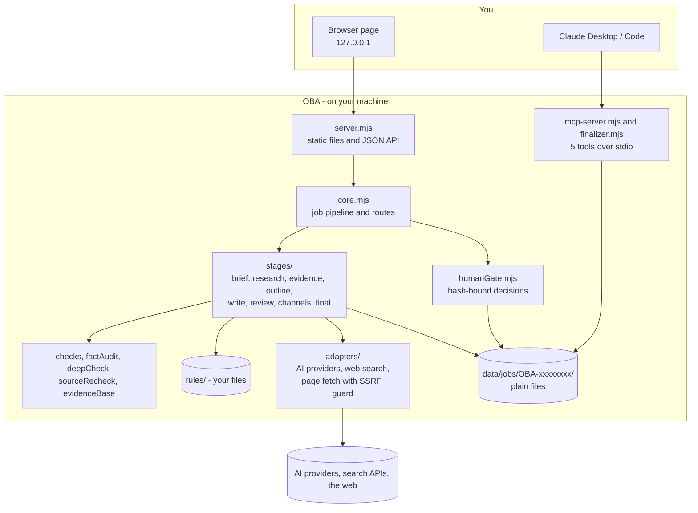

# Architecture

OBA is a small Node.js program (ES modules, no framework, no build step, no database).

## Layers

| Layer | Files | Job |
|---|---|---|
| **Web page** | `public/index.html`, `public/app.js` | Plain HTML/JS. Sends JSON to the local API. Escapes everything it renders |
| **Server** | `src/server.mjs` | Static files and `/api/*`. Binds `127.0.0.1`, checks `Host`/`Origin`/`Sec-Fetch-Site`, sets anti-framing headers |
| **Core** | `src/core.mjs` | Creates jobs, runs the eight stages in order, loops *review → write* up to 3 times, records usage and cost, serves the routes |
| **Stages** | `src/stages/*.mjs` | The pipeline. Each returns a result stored in `state.json` |
| **Checks** | `checks.mjs`, `factAudit.mjs`, `deepCheck.mjs`, `sourceRecheck.mjs`, `evidenceBase.mjs` | Everything decided **in code**: word counts, duplicate paragraphs, quote matching, number/name matching, hypothetical openings, evidence base |
| **Human Gate** | `src/humanGate.mjs`, `src/versions.mjs` | The review file, its SHA-256, decision validation and history, version copies |
| **Adapters** | `src/adapters/` | One function per AI provider (with model-specific quirks handled), web search providers, the page fetcher, a PDF reader, JSON repair for model output |
| **Rules loader** | `src/rules.mjs`, `src/language.mjs` | Reads `rules/` each call; per-language profiles |
| **MCP** | `src/mcp-server.mjs`, `src/finalizer.mjs` | The final-check tools, built on the same Human Gate checks |
| **Skills** | `src/skills/` | Cost tracker, analytics, review-issue memory, exports, importers, dashboard |

## Where the trust boundaries are

- **Model output is untrusted.** Quotes are verified by string matching against fetched text; claim ids are checked against the verified list; the AI reviewer's findings are kept only if they point at a sentence that really exists; leaked JSON/fences are detected.
- **Web content is untrusted.** Fetched pages go through an SSRF guard (public addresses only, redirects re-checked), are length-capped, and are presented to models and to MCP clients as *data*. Everything shown in the page or generated HTML is escaped.
- **The owner is the page.** Decisions need the browser's own headers; the MCP and any script cannot make them.

## How a job moves

1. `POST /api/jobs` creates `data/jobs/OBA-xxxxxxxx/state.json` and starts `runPipeline` in the background. Keys sent with the request live only in an in-memory map.
2. Each stage stores `{status, result}` in `state.json`. After **review**, if there are must-fix items (or a fixable length problem) and fewer than 3 rounds were used, it loops to **write**, which now edits the existing draft **sentence by sentence** (`revise.mjs`) instead of rewriting.
3. When all stages finish, `writeDeliverable` writes `blockdit.md`, records its SHA-256 and keeps a copy under `versions/`. The status becomes `ready_for_review` (no blockers) or `needs_revision`.
4. `POST /api/jobs/:id/decision` (owner channel only) validates the decision against the **current** file hash and records who/when/what.
5. After approval, the fact-check tools, the "other channels" drafts and the MCP tools become available — all of them re-verify that the file still matches the approval.

## Extending

| To… | Do this |
|---|---|
| Add an AI provider | Add `src/adapters/providers/<name>.mjs` returning parsed JSON plus `_usage`, register it in `src/adapters/index.mjs`, add rates in `costTracker.mjs`, add it to the menus in `public/` |
| Add a language | Add a profile to `src/language.mjs` |
| Add a template or pillar | See [RULES.md](RULES.md) |
| Add a search provider | Add a function in `src/adapters/webSearch.mjs` and call it from `collectCandidates` in `stages/research.mjs` |
| Change how channels look | `src/stages/channels.mjs` and `rules/BLOCKDIT_FORMAT.md` |

Keep the invariants: **no publisher**, **approval bound to a hash**, **a fact needs a verified quote**, **no unmeasurable scores**.
